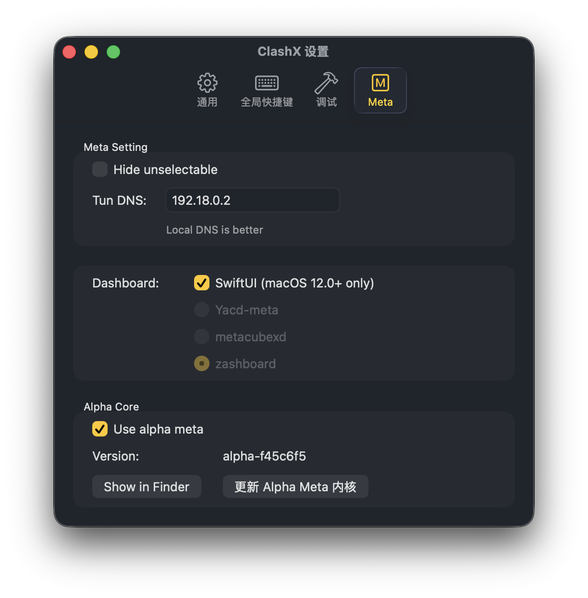

# Clash Config Script

一个基于 Cloudflare Workers 的订阅转换 api 服务，用于将机场订阅转换为优化的 Clash 配置文件，并提供 token 订阅管理。

[](https://deploy.workers.cloudflare.com/?url=https%3A%2F%2Fgithub.com%2Fjctaoo%2FClashConfig)

## ✨ 特性

- 🚀 **无服务器部署**: 基于 Cloudflare Workers，全球加速访问
- 📦 **跨平台使用**: 提供 **Mihomo (Clash.Meta)** 和 **Stash** 的配置分支，具体差异见 [内核能力与当前适配范围](#core-compatibility)
- 🎯 **智能规则**: 内置优化的分流规则，支持 GEOIP、GEOSITE 数据，多 DNS 与分流规则可配置
- 🔒 **安全的网络体验**: 避免 DNS 泄露
- 🌍 **地区筛选**: 支持按地区过滤节点
- 🔐 **Token 管理**: 支持 Token 订阅管理，可配置节点过滤，feel free to share token with your friends
- ⚙️ **CLI 工具**: 提供命令行工具，方便管理订阅和生成 token
- 📒 **生成脚本**: 支持生成全局扩展脚本，适配 Clash Verge 等客户端
- 🎮 **裸核心支持**: 支持直接使用 Clash 核心运行，无需客户端 UI

## ⚡ 快速开始

打开 [https://clash.jctaoo.com](https://clash.jctaoo.com) 来使用, 或者将原始订阅链接转换为 base64 编码后，直接使用下面的链接作为订阅 URL

```txt
https://clash.jctaoo.com/sub?sub=<base64-encoded-url>
```

> 更进一步，可以使用基于 token 管理的配置获取 API，支持筛选节点等功能，参考下方 API 指南

## 🖥️ API 指南

### 📱 User-Agent 说明

ClashConfig 会**根据请求的 User-Agent 自动识别客户端类型**，并返回对应内核的优化配置：

#### 支持的客户端内核

1. **Clash.Meta (Mihomo)**:
   - 客户端：Clash Verge、ClashX.Meta 等
   - 返回：Mihomo 配置分支，根据客户端与平台补充 TUN 等配置, 包含所有高级特性

2. **Clash Premium (Stash)**
   - 客户端：Stash
   - 返回：兼容 Stash 的配置，自动展开 `GEOSITE` 规则为具体域名列表 (nameserver-policy 中)
   - 当前实现将 `strict` DNS 选项按 `direct` 生成，客户端能力与项目限制见 [下表](#core-compatibility)

#### 裸核心使用方法

如果你直接使用 Clash 核心（如 `mihomo`）而不是带 UI 的客户端，需要**手动指定 User-Agent**, 将 `mihomo -v` 命令的第一行返回值作为 User-Agent 使用即可，例如:

```bash
> ./mihomo.exe -v
Mihomo Meta v1.19.14 windows amd64 with go1.24.7 Wed Sep 24 09:12:02UTC 2025
Use tags: with_gvisor
```

将 `Mihomo Meta v1.19.14 windows amd64 with go1.24.7 Wed Sep 24 09:12:02UTC 2025` 作为 User-Agent 进行请求即可。

> 💡 **提示**：大多数 Clash 客户端会自动发送正确的 User-Agent，无需手动设置

### 1. `/sub` - 基础订阅转换

**功能**: 将机场订阅地址转换为优化后的 Clash 配置

**参数**:

- `sub` (必需): Base64 编码的订阅 URL
- `convert` (可选): 是否进行配置优化，默认 `true`，设置为 `false` 则原样返回上游订阅并转换为客户端需要的格式
- `regions` (可选): 基于地区节点过滤，使用逗号分隔，如：`HK,US,JP`
- `rate` (可选): 基于计费倍率过滤，只保留计费倍率小于等于该值的节点，默认为空
- `filter` (可选): 节点名称过滤正则，移除掉不符合该正则的节点，该参数会传入 js 的 `RegExp`，默认为空
- `nameserver` (可选): 设置 dns nameserver 组, 支持 `direct` 和 `strict`，默认 `strict`
- `rules` (可选): 未命中规则流量 dns 解析策略，支持 `always-resolve` 和 `remote`，默认 `remote`
- `quic` (可选): 禁用 quic，默认 `true`
- `level` (可选): 日志等级，支持 `debug`, `info`, `warning`, `error`, `silent`，默认 `warning`

> 参见 [参数说明](#params) 了解更多

**使用示例**:

```txt
https://clash.jctaoo.com/sub?sub=<base64-encoded-url>
https://clash.jctaoo.com/sub?sub=<base64-encoded-url>&convert=false
```

### 2. `/:token` - Token 订阅

**功能**: 使用 Token 获取订阅，相当于短链接的效果，不会在 url 上暴露订阅地址和参数，可以配置过滤节点后分享给他人使用

> 处于安全考虑，该接口的 Token 仅能通过 cli 工具进行生成，并且支持自部署的方式，参见 [CLI 工具使用指南](#cli) 和 [部署](#deploy)

**参数**:

- `token` (必需): 通过 CLI 工具生成的用户 Token（格式: `sk-xxxxx`）

**使用示例**:

``` txt
https://clash.jctaoo.com/sk-your-token
```

**使用流程**:
1. 使用 `pnpm run cli add` 添加订阅并获取 token
2. 将 token 添加到 Clash 订阅地址: `https://clash.jctaoo.com/sk-your-token`
3. 使用 CLI 工具管理和更新订阅配置

## 💡 客户端说明

- 可以为订阅设置自动更新，1440分钟更新一次
- clash-verge-rev: 打开 虚拟网卡模式，关闭系统代理，虚拟网卡配置中，开启 严格路由
- clashx.meta: 根据如下图片配置，然后使用 tun 模式，关闭系统代理 
  > https://github.com/MetaCubeX/ClashX.Meta/issues/103#issuecomment-2510050389
- 其他客户端: 使用 tun 模式

<a id="core-compatibility"></a>

## 内核能力与当前适配范围

下表按当前生成器的实际行为整理，区分内核能力、客户端差异和本项目尚未完成的适配。`strict`、`direct` 是本项目的 DNS 选项名称，不是客户端必须提供的同名配置键。

### 客户端识别与输出分支

| 客户端 / 内核 | 当前处理方式 |
| --- | --- |
| Mihomo，以及 Clash Verge、ClashX.Meta、Clash Meta for Android、Clash Party | 按 User-Agent 进入 Mihomo 配置分支；部分 TUN、控制面板设置还取决于客户端和平台 |
| Stash | 单独识别并使用 Stash DNS 配置；代码内部将其归入 `ClientCoreType.ClashPremium`，这是生成器的分类名称，不表示 Stash 就是原版 Clash Premium |
| 原版旧 Clash、原版 Clash Premium | 没有独立的识别与兼容分支。未知但以 `clash` 开头的 User-Agent 会被归入 `UnknownClash`，继而按 Mihomo 生成；请求被接受不代表生成配置与旧内核兼容 |

### 使用中的能力及差异

| 功能 / 配置 | 当前项目行为 | 能力范围与适配边界 |
| --- | --- | --- |
| 落地代理：`dialer-proxy` | Mihomo 和 Stash 共用 SOCKS5 落地节点与独立选择组，前置引用机场地区组；Stash 分支同时为落地域名生成 DNS 策略，并移除生成的 SVG 图标 | [Mihomo 支持](https://wiki.metacubex.one/config/proxies/dialer-proxy/)；[Stash 支持节点或策略组作为前置](https://stash.wiki/proxy-protocols/dialer-proxy)，要求 iOS/tvOS 3.2.5+、macOS 4.1+。服务按 User-Agent 识别客户端，未校验版本；Stash 配置生成与 Token 路由已覆盖测试，尚未实机验证出口连通性 |
| `strict` DNS 方案：境外默认 DNS、国内域名分流及直连出口 DNS | Mihomo 分支输出 `direct-nameserver`、`direct-nameserver-follow-policy` 和国内集合的 `nameserver-policy`；Stash 分支目前固定使用国内 DNS | 这是当前生成器两套方案的差异。Mihomo 的字段含义见 [DNS 文档](https://wiki.metacubex.one/config/dns/)；不能仅据本项目的回退处理断言 Stash 无法实现类似 DNS 分流 |
| DNS 查询跟随路由 | Mihomo 使用 `respect-rules: true`；Stash 使用 `follow-rule: true` | 两者均有相应能力，字段不同，分别见 [Mihomo DNS](https://wiki.metacubex.one/config/dns/) 与 [Stash DNS](https://stash.wiki/features/dns-server)；不能把 `respect-rules` 这个字段名等同于所有客户端的通用格式 |
| 代理服务器域名的专用 DNS | Mihomo 输出 `proxy-server-nameserver`；Stash 分支目前把每个代理服务器域名加入 `nameserver-policy` | [现行 Stash 文档](https://stash.wiki/features/dns-server) 已列出 `proxy-server-nameserver`，要求 iOS/tvOS 3.6+、macOS 4.3+。项目尚未按这些版本切换为该字段 |
| DNS 的 `geosite:` 集合引用 | Mihomo 在 `fake-ip-filter`、`nameserver-policy` 中直接引用集合；Stash 分支读取 geosite 数据中的 `private`、`connectivity-check` 并展开域名条目 | [现行 Stash 文档](https://stash.wiki/features/dns-server) 也支持这些 DNS 集合引用。当前展开属于保留的适配方式，不应写成所有 Stash 版本都不支持 `geosite:`；这里也没有展开路由中的全部 `GEOSITE` 规则 |
| 路由中的 `GEOSITE`、`AND`、`NOT` | 两个分支共用规则生成器，直接保留域名集合规则和逻辑规则 | [Mihomo 路由文档](https://wiki.metacubex.one/config/rules/) 和 [Stash 规则文档](https://stash.wiki/rules/rule-types) 均列出这些规则能力。这些规则没有转换为旧 Clash 的兼容格式 |
| QUIC 拦截中的 `NETWORK,UDP` | 启用禁用 QUIC 选项时，两个分支都输出包含 `DST-PORT,443`、`NETWORK,UDP` 和 `GEOSITE`/`GEOIP` 的组合规则 | 规则按 Mihomo 语法生成。[Stash 文档的 QUIC 示例](https://stash.wiki/rules/rule-types) 使用 `SCRIPT` 判断 `network` 和 `dst_port`；本项目没有转成该写法，尚未确认现有组合规则在 Stash 上的兼容性 |
| `RULE-SET` 与远程 `rule-providers` | 两个分支均输出，使用 `domain`、`ipcidr`、`classical` 类型的规则集 | Mihomo 和 Stash 均有规则集合能力；[旧 Clash 历史文档](https://en.clash.wiki/premium/rule-providers.html) 将其列为 Premium 功能，不能把当前生成配置视为兼容旧开源 Clash |
| 自动组的 `include-all` | 延迟选优、故障转移和两种负载均衡使用 `include-all: true`，启用落地后也会纳入落地节点；落地的前置地区组只包含筛选后的机场节点 | [Mihomo](https://wiki.metacubex.one/config/proxy-groups/) 和 [现行 Stash](https://stash.wiki/proxy-protocols/proxy-groups) 均支持该字段，并非 Mihomo 独有。项目没有为旧 Clash/Premium 生成相应兼容配置 |
| Mihomo 扩展的全局配置 | 通用生成器输出 `geodata-mode`、`geodata-loader`、`geox-url`、`geo-auto-update`、`geo-update-interval`、`unified-delay`、`tcp-concurrent` | 这些字段按 [Mihomo 全局配置](https://wiki.metacubex.one/config/general/) 的格式和语义设置。目前 Stash 分支也会收到这些字段，但没有逐项转换；不能据此认定其他内核会按同样语义生效 |
| 策略组 SVG 图标 | Mihomo 分支保留 SVG `icon`；Stash 分支删除生成的 SVG 图标 | 这是客户端显示适配。[Stash 图标文档](https://stash.wiki/configuration/proxy-group-icon) 列出的格式为 JPG、PNG；本项目没有生成对应的替代图片 |
| 自动补充 TUN 配置 | ClashX.Meta 写入 macOS 的 `utun6`、`gVisor` 等配置；Windows 裸 Mihomo 写入 `Mihomo` 设备、`gvisor`、自动路由和严格路由等配置；其他客户端没有这个自动补充分支 | 属于客户端和平台差异。TUN 本身并非 Mihomo 独有，旧 Clash Premium 的 [历史功能列表](https://en.clash.wiki/premium/introduction.html) 也包含 TUN；当前项目没有为所有客户端生成统一 TUN 配置 |
| 裸核心控制接口与面板 | 识别为裸 Mihomo 时，补充 `external-controller`、`external-ui`、`external-ui-url`、`external-ui-name` 和 `external-controller-cors`，使用 zashboard | 当前自动配置面向裸 Mihomo。外部控制接口这个概念不等于 Mihomo 独有；具体面板下载和 CORS 字段按 [Mihomo 全局配置](https://wiki.metacubex.one/config/general/) 生成 |

### 旧 Clash 的链式代理

[旧 Clash 的历史出站文档](https://en.clash.wiki/configuration/outbound.html#relay) 描述了 `type: relay` 策略组，流量按节点列表顺序转发，并注明不支持 UDP。本项目落地功能只生成节点上的 `dialer-proxy`，没有输出旧 Clash 的 `relay` 兼容配置。因此，“旧 Clash 能做链式代理”与“能直接使用本项目当前生成的落地配置”是两件事。

地区、倍率与名称过滤，Token/KV 管理，以及 URL 参数解析，属于本服务自身的能力，不是某个代理内核的专属功能。机场节点配置主要沿用上游订阅，本服务不会把节点协议转换成另一个内核支持的协议。

<a id="deploy"></a>

## ☁️ 部署

使用 Cloudflare Workers 快速部署，点击下方按钮即可

[](https://deploy.workers.cloudflare.com/?url=https%3A%2F%2Fgithub.com%2Fjctaoo%2FClashConfig)

<a id="cli"></a>

## 🔧 CLI 工具使用指南

这是一个用于管理 Cloudflare KV 中订阅的命令行工具。

### CLI 命令

#### 1. 添加订阅（交互式）

```bash
pnpm run cli add
```

该命令会通过交互式提示引导你输入所有必要信息，并自动生成 token。参数说明参见 [参数说明](#params)。

#### 2. 获取订阅信息

```bash
pnpm run cli get sk-your-token
```

该命令会显示指定 token 的订阅详细信息。Token 会保存在订阅信息中，可以随时通过此命令重新获取。

#### 3. 获取订阅链接

```bash
# 使用默认 base-url (https://clash.jctaoo.com)
pnpm run cli link sk-your-token

# 获取链接并自动在 Clash 中打开
pnpm run cli link sk-your-token --go
# 或使用简写
pnpm run cli link sk-your-token -g

# 自定义 base-url
pnpm run cli link sk-your-token --base-url https://your-worker.workers.dev

# 自定义 base-url 并打开
pnpm run cli link sk-your-token -b https://your-worker.workers.dev -g
```

该命令会生成完整的订阅链接。使用 `--go`/`-g` 参数可以自动生成 Clash URL scheme 并打开 Clash 客户端导入配置。

**参数说明：**
- `--base-url` / `-b`: Worker 部署的 base URL（默认：`https://clash.jctaoo.com`）
- `--go` / `-g`: 生成 Clash URL scheme 并自动打开（支持 Windows/macOS/Linux）

#### 4. 更新订阅（使用编辑器）

```bash
pnpm run cli update sk-your-token
```

该命令会打开你的默认编辑器，显示当前订阅信息的 JSON 格式，你可以直接在编辑器中修改。保存后会自动更新订阅。参见 [参数说明](#params)。

#### 5. 删除订阅

```bash
pnpm run cli delete sk-your-token
```

#### 6. 列出所有订阅

```bash
pnpm run cli list
```

该命令会列出所有已保存的订阅信息，包括 token、标签、URL 等关键信息。

### KV Key 格式

- **用户 Token 格式**: `sk-{32位随机十六进制字符串}`
- **KV Key 格式**: `kv:{SHA256(用户Token)}`
- **存储值**: JSON 格式的 `ClashSubInformation` 对象

### Token 落地代理

Mihomo 和 Stash 均可通过 Token 配置中的可选 `landingProxies` 数组使用落地代理。Stash 的版本要求见 [内核能力与当前适配范围](#core-compatibility)。运行 `pnpm run cli update sk-your-token`，在现有 JSON 中加入以下字段；`pnpm run cli add` 也可以选择通过编辑器配置落地数组。

```json
{
  "landingProxies": [
    {
      "name": "🇸🇬 新加坡落地",
      "viaRegion": "hk",
      "proxy": {
        "type": "socks5",
        "server": "example.com",
        "port": 443,
        "username": "your-username",
        "password": "your-password",
        "udp": false
      }
    }
  ]
}
```

这只是需要新增的字段，编辑时保留原有的 `token`、`url`、`filter` 等字段。保存后继续使用原来的 Token 订阅链接。

- `name` 是独立落地选择组的名称；对应节点名称自动生成为 `${name}节点`，两者都不能与已有节点或策略组重名。
- `viaRegion` 是前置机场地区，支持 `hk`、`mo`、`jp`、`tw`、`sg`、`us`、`gb`、`de`、`fr`、`nl`、`kr`、`au`、`ca`，大小写均可。前置地区仍须满足 Token 的地区、倍率和名称过滤条件；筛选后为空会返回配置错误。
- 首版落地协议为 `socks5`，`server` 支持域名或 IP，`port` 必须为 1–65535 的整数；`username`、`password` 可选。`udp` 默认关闭，启用后还需前置节点与落地服务共同支持 UDP。
- 多个落地分别生成独立选择组，加入国外媒体、AI、Google AI、Bybit、PikPak、电报、谷歌、苹果、微软九个业务组。更新订阅后，在客户端中为需要的业务选择落地组；原来的默认选项顺序保持不变。
- 示例链路为：`本机 → 香港机场节点 → 新加坡 SOCKS5 落地 → 目标网站`。具体香港前置节点在“🇭🇰 香港节点”组中选择。
- 启用落地后，延迟选优、故障转移和负载均衡会同时纳入机场节点与落地节点。落地节点不进入普通地区组，前置地区组仍只包含筛选后的机场节点。
- 删除 `landingProxies` 字段或设为 `[]` 可停用。Mihomo 和 Stash 使用相同的落地配置格式，无需为客户端分别维护 Token 配置。

落地配置仅通过 Token 管理，`/sub` 的 URL 参数和网页表单不提供此入口。持有 Token 订阅链接的人可以获取包含落地凭据的生成配置。

实现使用 Mihomo 与 Stash 均支持的节点级 `dialer-proxy`，分别参见 [Mihomo 代理链](https://wiki.metacubex.one/config/proxies/dialer-proxy/)、[Mihomo SOCKS5 出站配置](https://wiki.metacubex.one/config/proxies/socks/) 与 [Stash 代理链](https://stash.wiki/proxy-protocols/dialer-proxy)。

### 示例：完整工作流

```bash
# 1. 添加订阅
pnpm run cli add

# 2. 查看订阅信息
pnpm run cli get sk-your-token

# 3. 获取订阅链接并在 Clash 中打开
pnpm run cli link sk-your-token --go

# 4. 更新订阅
pnpm run cli update sk-your-token

# 5. 列出所有订阅
pnpm run cli list

# 6. 删除订阅
pnpm run cli delete sk-your-token
```

### CLI 注意事项

1. **Token 持久化**: 生成的 User Token 会自动保存在订阅信息中，可以随时通过 `get` 命令重新获取，无需担心丢失
2. **KV 命名空间**: 默认使用 wrangler.jsonc 中配置的 KV binding (默认为 "KV")
3. **Wrangler 依赖**: 需要安装并配置 Wrangler CLI
4. **身份验证**: 确保已通过 `wrangler login` 登录到 Cloudflare 账户


<a id="params"></a>

## 📃 参数说明

| 参数 | 字段 | 说明 | 默认值 | 是否必填 |
| --- | --- | --- | --- | --- |
| 订阅链接 | `sub` | base64 编码的订阅 URL | 无 | ✅ |
| 是否进行配置优化 | `convert` | false 原样返回上游订阅并转换为客户端需要的格式 | true | ❌ |
| 基于地区节点过滤 | `regions` | 用逗号分隔，如：HK,US,JP | 无 | ❌ |
| 基于计费倍率过滤 | `rate` | 只保留计费倍率小于等于该值的节点 | 无 | ❌ |
| 节点名称过滤正则 | `filter` | 移除掉不符合该正则的节点，该参数会传入 js 的 `RegExp` | 无 | ❌ |
| dns 设置 | `nameserver` | 设置 dns nameserver 组, 支持 `direct` 和 `strict` | `strict` | ❌ |
| dns 解析策略 | `rules` | 未命中规则流量 dns 解析策略，支持 `always-resolve` 和 `remote` | `remote` | ❌ |
| 禁用 quic | `quic` | 禁用 quic | true | ❌ |
| 日志等级 | `level` | 日志等级，支持 `debug`, `info`, `warning`, `error`, `silent` | `warning` | ❌ |

两种 DNS 策略的排列组合会形成不同的效果，根据实际需求来做选择

> 🔒 表示不会 DNS 泄露， ⚠️ 表示有相关风险，但不代表一定泄露，如果需求只是对于绝大多数如 google 在内的黑名单网站不泄露，则可以忽视相关泄露风险

| rules / nameserver | `direct` | `strict` |
| ----------- | ------ | ------ |
| `always-resolve` | ⚠️ `国外未知域名通过 direct dns，泄露` | 🔒 `缺点在于国外小众网站会进行多余 DNS 解析，国内小众网站可能无法命中最优结果，但 ecs 有所缓解` |
| `remote` | 🔒 `缺点在于国内小众网站会走代理` | 🔒 `缺点在于国内小众网站会走代理` |

> 目前 Stash 不支持 `strict` 策略，如果指定 `strict` 策略，会自动切换为 `direct` 策略。另外使用 `direct` 策略的同时最好打开 `quic` 选项来禁用 quic 协议


## 💻 Development

### 前置要求

1. 安装 Node.js 和 `pnpm`（请先安装 Node.js，然后参见 [pnpm](https://pnpm.io) 获取 pnpm 安装说明）

### 开发步骤

1. **安装依赖**
   ```bash
   pnpm install
   ```

2. **登录 Cloudflare**（重要！）
   ```bash
   pnpm exec wrangler login
   ```
   这将打开浏览器进行 Cloudflare 账户授权。登录后才能访问 KV 存储和部署服务。

3. **生成 Geo 相关脚本**
   ```bash
   pnpm run pb-gen && pnpm run pb-gen-dts
   ```

4. **生成 Cloudflare Workers 类型定义**
   ```bash
   pnpm run cf-typegen
   ```
   这将根据 `wrangler.jsonc` 配置生成 TypeScript 类型定义文件，包括 KV、环境变量等的类型。

5. **启动开发服务器**
   ```bash
   pnpm run dev
   ```
   开发服务器将在本地启动，可以进行调试和测试。


### 本地测试

测试使用 Vitest 在 Node.js 环境中运行。`vitest.config.ts` 将 `cloudflare:workers` 映射为内存 KV 替身；Stash 路由测试中的 geosite 域名提取使用固定数据替代。测试用于验证配置生成和 Token 路由逻辑，不访问远端 KV 或订阅，也不在 workerd 中执行。

```bash
pnpm test
pnpm run test:watch
```

## 🎯 TODO

- [ ] 1. 迁移到 GEOSITE, 避免使用 classic behavior 规则，stash 支持 `strict` 策略 
- [ ] 2. 检查 https://github.com/DustinWin/ShellCrash/blob/dev/public/fake_ip_filter.list 以补全 fake-ip-filter
- [ ] 3. subrequest 被 cloudflare 缓存

